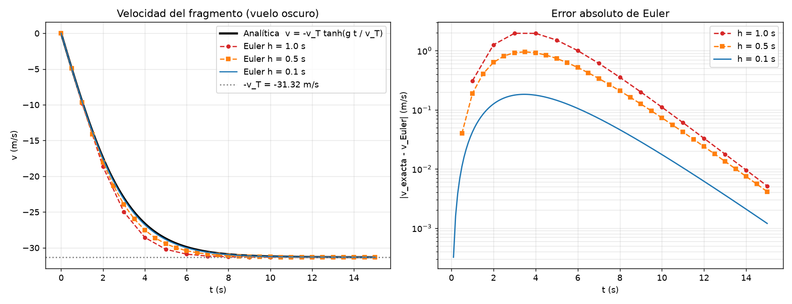

# ☄️ Vuelo oscuro: caída de un fragmento de asteroide con el método de Euler

Ejercicio 42 de **Métodos Numéricos** (UMSA): solución por Euler, solución analítica y su explicación en el contexto de la caída de un asteroide.

**Página interactiva:** https://angelsky2.github.io/euler-asteroide/

## Enunciado

```
m dv/dt = −m g + k v² ,   m = 5 kg, k = 0.05 kg/m, g = 9.81 m/s², v(0) = 0, 0 ≤ t ≤ 15 s
```

## Solución analítica

Con `v_T = √(mg/k) = √981 = 31.3209 m/s` (velocidad terminal, ≈ 113 km/h):

```
v(t) = −v_T · tanh(g t / v_T) = −31.3209 · tanh(0.31321 t)   [m/s]
d(t) = (v_T²/g) · ln cosh(g t / v_T) = 100 · ln cosh(0.31321 t)  [m]   → d(15) ≈ 400.5 m
```

**Verificación:** dv/dt = −g·sech²(u) y −g + (k/m)v² = −g(1 − tanh²u) = −g·sech²(u) ✔; v(0) = 0 ✔.

## Método de Euler

`v_{n+1} = v_n + h·(−g + (k/m)·v_n²)`, con k/m = 0.01 m⁻¹.

| t (s) | Euler h = 1 | Euler h = 0.1 | Exacta | Error (h = 1) |
|---|---|---|---|---|
| 1 | −9.810000 | −9.543359 | −9.501320 | 0.3087 |
| 2 | −18.657639 | −17.526780 | −17.401310 | 1.2563 |
| 3 | −24.986564 | −23.199451 | −23.022476 | 1.9641 |
| 5 | −30.210382 | −28.846897 | −28.702319 | 1.5081 |
| 10 | −31.312448 | −31.219388 | −31.201922 | 0.1105 |
| 15 | −31.320858 | −31.316915 | −31.315719 | 0.0051 |

Error máximo: 1.96 m/s con h = 1, 0.95 con h = 0.5 y 0.18 con h = 0.1. Euler es de **orden 1**: el error es proporcional a h.



## Contexto: el asteroide (escenario hipotético, 2027)

Un asteroide pequeño se fragmenta en la atmósfera. Cada fragmento, cuando pierde su velocidad cósmica, entra en **vuelo oscuro**: cae frenado solo por el aire, que es justamente lo que describe esta ecuación.
El fragmento llega a la **velocidad terminal de ≈ 31 m/s (113 km/h)** en ≈ 10 s y ya no acelera más.
La energía de impacto, ≈ 2.45 kJ, equivale a soltar el fragmento desde unos 50 m: puede romper un techo, pero no hace cráter.
La explicación completa está en [SOLUCION.md](SOLUCION.md) y en la página web.

## Ejecutar

```bash
python3 -m http.server 8080              # página web → http://localhost:8080
cd python && pip install numpy matplotlib && python euler_asteroide.py   # tablas + gráfica
```

Este trabajo continúa en **“Euler en el espacio”** (reentrada de la cápsula Friendship 7, película *Talentos ocultos*).
